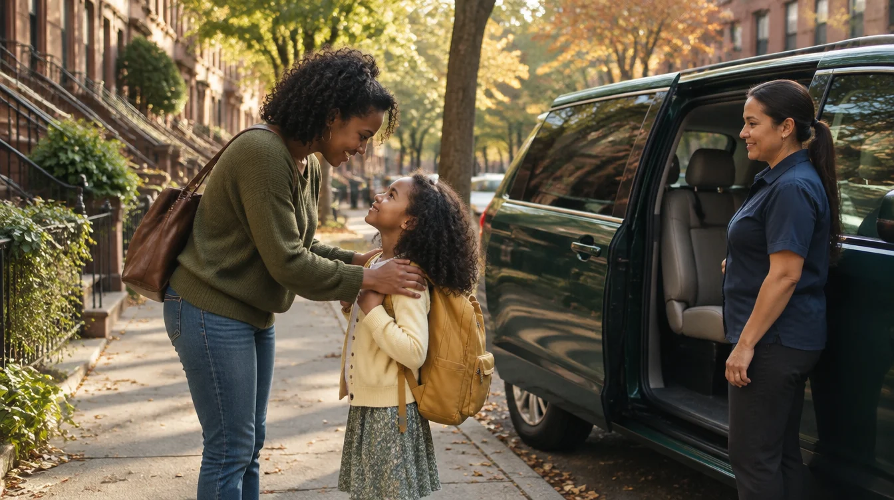
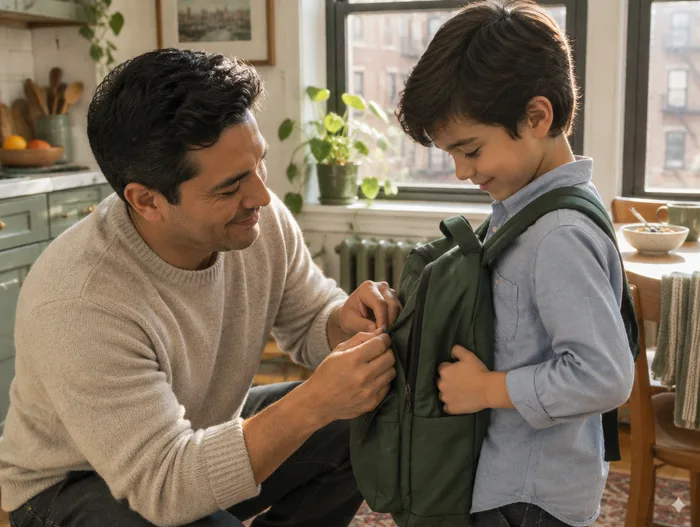
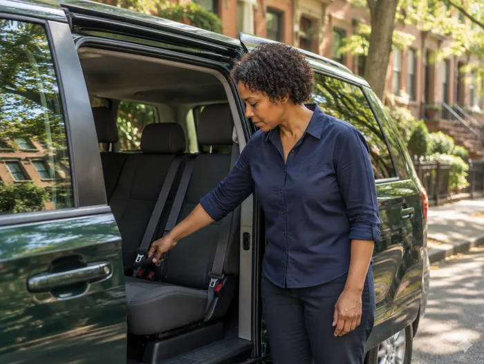
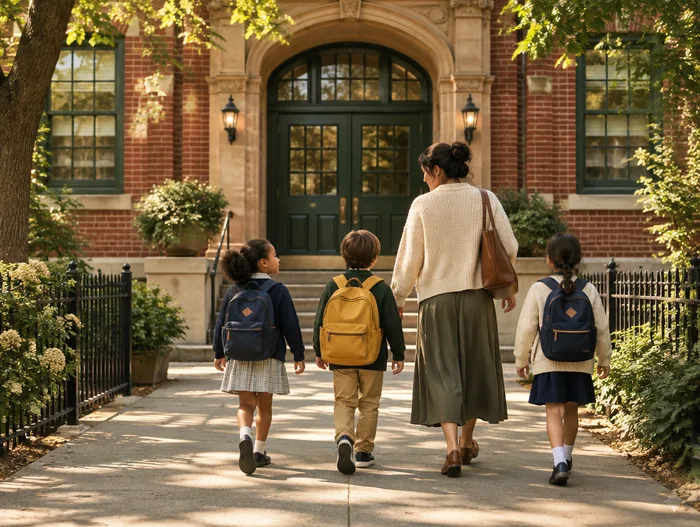

# TroTro — a little more care, all the way there

## Existing-site audit · October 21, 2026
Reviewed the live homepage, /parents, /schools, /safety, /about, /contact, /download, /privacy and /terms, including public form code. The workspace was empty: no source, backend, credentials or deployment configuration was supplied. The live site uses Next.js; the redesign follows that stack.

The current hero leads with “Student transportation, connected,” app screenshots and app downloads. Its most persuasive evidence is lower down: advance route planning, assigned people, visible driver identity, recorded checkpoints and confirmed stops. The redesign brings those facts into the family story. The school page's provisional discovery → demand review → route planning → parent onboarding → pilot review process is retained without promising universal availability.

Verified facts: plans start at $85/week, exact plan confirmed after a call; service depends on school and area; drivers operate their own vehicles; controlled pilot; invitation-only driver onboarding; identity/license, driving record, background, vehicle inspection and training checkpoints; current verification gates route starts; pickup/drop-off records; active ride tracking, notifications, history and driver details. Verification is not government certification, insurance or a guarantee.

Sources: https://www.jointrotro.com/ and the eight paths above. Legal text is preserved from the current public pages. Real product screenshots are copied from the site's /app-screens/ paths. Existing App Store and Google Play URLs are retained. No documented partner logos, attributed reviews, approved founder portraits or names were available. Do not publish fabricated substitutes.

## Moodboard and visual system
- Paper #F8F7F0: uncoated school-note warmth.
- Pine #243F34: responsible, settled, legible primary ink.
- Meadow #E5E9DC: quieter story backgrounds.
- Marigold #EAC875: morning light and small focal accents.
- Chalk #FFFFFF: product screenshot ground.
- Stone #5D685F: supporting text, never low-contrast gray.
- Lora: generous, confident editorial headings. Manrope: friendly, precise body and navigation. Self-hosted WOFF2 fonts.
- Broad photographs with one curved corner evoke a bend in a route. The route line is reserved for the school-morning sequence. Minimal pills, no floating dashboards, no feature-card wall.

## Composition
Hero: left-aligned editorial headline + large right-side family photograph; availability first, school pathway visible. A small film button opens a user-controlled silent film. The photograph remains the fast-loading first impression.

[ wordmark    family / school / safety / story      availability ]
[ big human headline       |  school-morning photograph          ]
[ two actions / disclosure |  film control                       ]
[        care / coordinated rides / parents kept informed        ]
[ intimate preparation photograph | parent reality              ]
[ operational responsibility + three open editorial columns      ]
[ four-stage interactive school morning / photograph / real app  ]
[ pine safety section: plain-language checks / verification       ]
[ real app screenshots | reassuring everyday benefits            ]
[ school arrival image | partnership story                       ]
[ mission statement / family and school closing pathways         ]

Review: warm paper and serif type are specifically requested by this brief. Distinction comes from real school-morning compositions, a usable four-stage journey, restrained curved image crops and the service-first content; remove decorative eyebrows on every section, generic cards, fake badges and repeated reveal animations.

## Photography and film
Higgsfield custom generated illustrative scenes, consistent 35mm treatment, natural honey light, diverse NYC families, plain passenger minivans, no invented vehicle branding. AI scenes are explicitly labeled as illustrative, never proof of real people or operations. No synthetic product UI. Authentic screenshots retain their visual content and receive “Product preview” context.

Film: preparation → walking to the parked vehicle → driver greeting → parent checking phone → real app notification insert → school arrival → parent continuing morning. Sound is unnecessary. User-controlled playback; preload none. Mobile gets a small optimized source. No background autoplay; reduced motion respected.

## Page structure
Homepage; parents with real FAQs and pricing; schools with five actual provisional steps; safety with complete checkpoints and limits; about with documented mission and no fake biography; contact with parent/school/general email preparation and links to the existing live online forms; download; original privacy and terms.

## Functional boundary
The existing forms submit private Next.js server actions, not a stable public API. Do not hard-code deployment-specific action hashes or pretend a new form delivers to that backend. Preserve live online forms through explicit links. Local inquiry forms prepare an editable email, require a review, and never report a message as sent. Connecting a first-party delivery backend requires the original source or an approved API. No inquiry is sent during development/testing.

## Partner treatment
Updated October 21, 2026: the user supplied a ten-school list for the requested “Trusted by” homepage carousel. Nine school logos are sourced from official websites; one school uses its name in text. `/partner-preview` remains an internal noindex preview of the same carousel. Source details are in `docs/school-logo-sources.md`.

## Responsive and performance
Desktop split layout becomes single-column below 900px. Mobile type 44–52px; minimum 44px controls; native details/summary FAQs; accessible menu and dialog with focus return; keyboard-friendly journey tabs; visible focus, contrast, semantic headings and reduced motion. Static prerendered pages, optimized local WebP images, local WOFF2 fonts, lazy secondary images, video loaded only on request. SEO metadata, canonical URLs, sitemap and robots; no fabricated review or partner structured data.

## Produced photographic moodboard

The images below implement the agreed direction and are synthetic illustrations.

